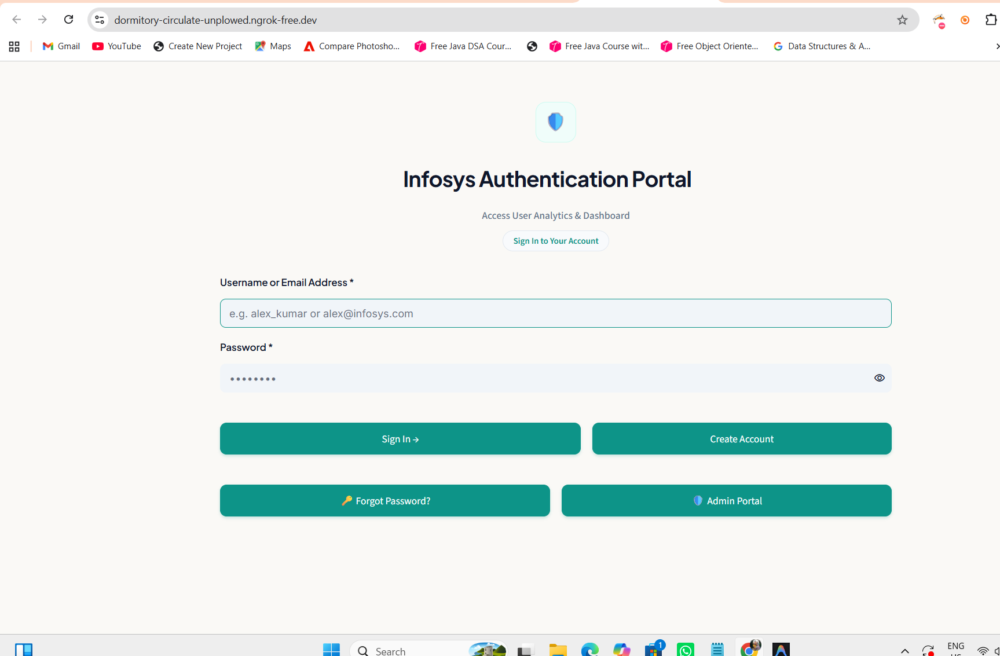
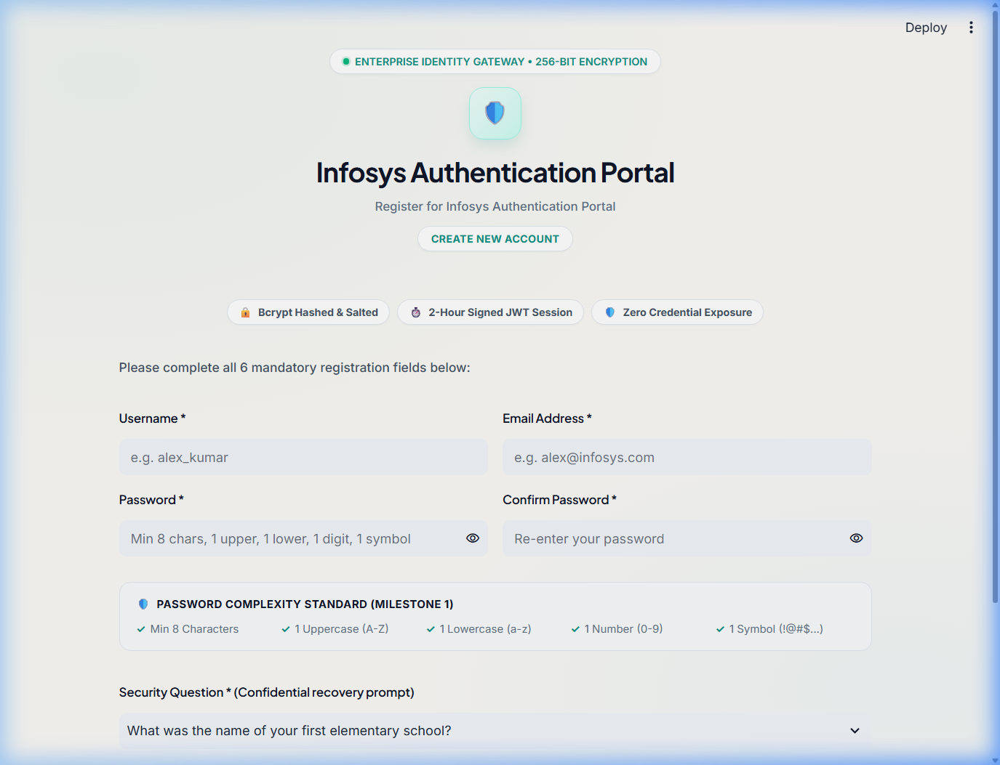
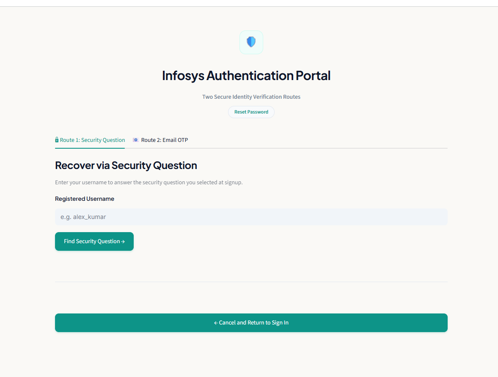
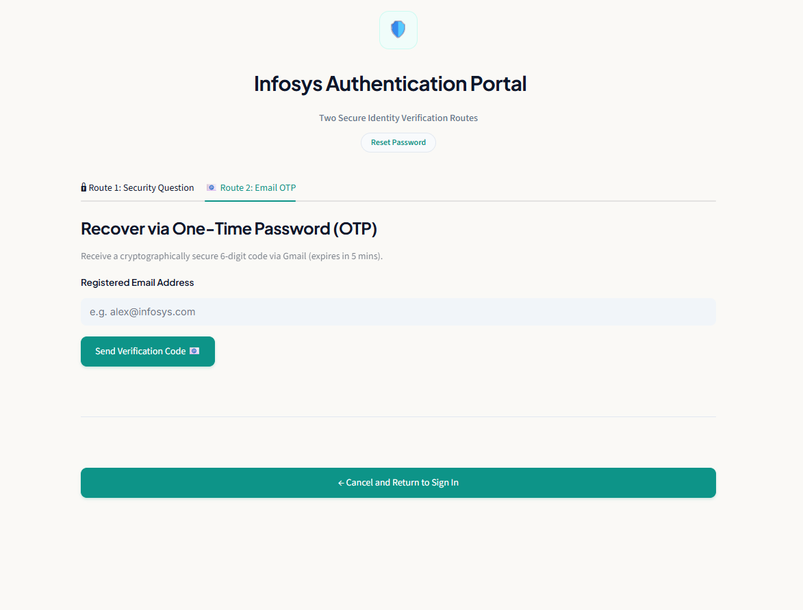
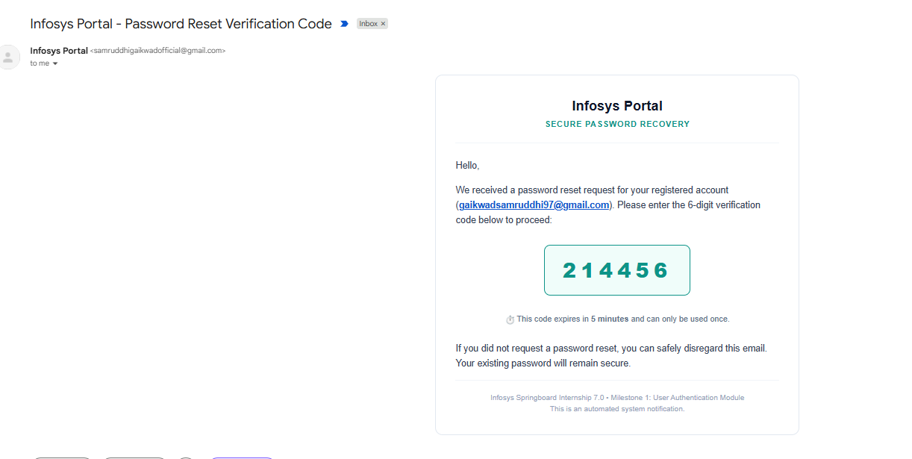
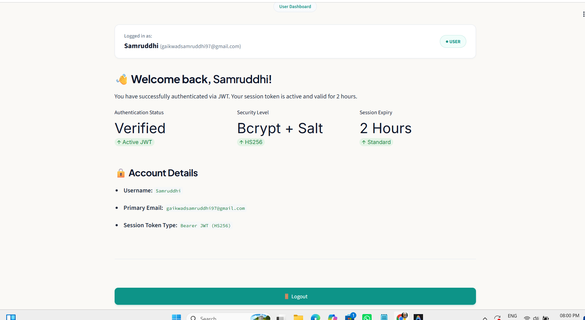
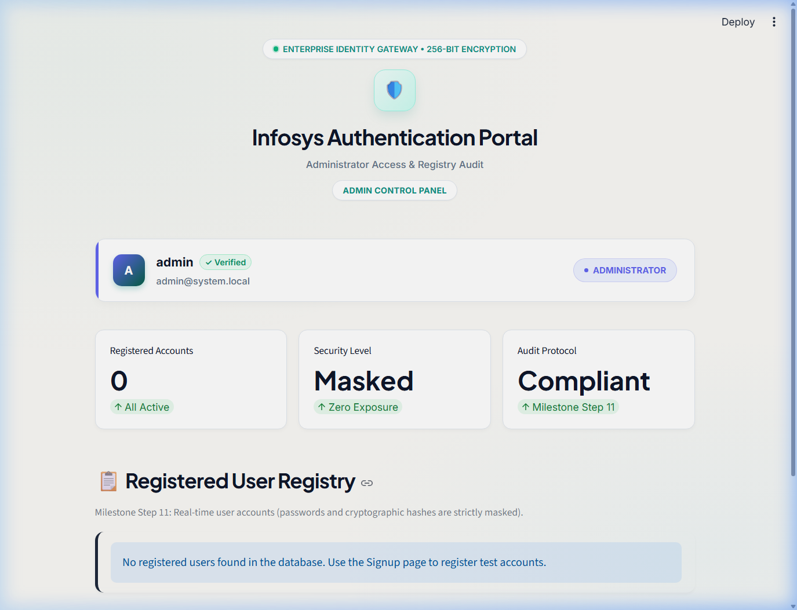

# Infosys Springboard Internship 7.0 &bull; Batch 4
## Milestone 1: User Authentication Module

A secure, production-grade, and enterprise-styled User Authentication Portal built with **Python**, **Streamlit**, **SQLite**, **JWT (JSON Web Tokens)**, **bcrypt**, **Gmail OTP via SMTP**, **Google Colab Secrets**, and **ngrok**.

---

## 📌 Executive Summary

Milestone 1 implements an end-to-end user authentication and account recovery infrastructure for the Infosys Springboard Internship program. The portal provides robust identity verification, strict input validation, salted cryptographic hashing, session management via signed JWTs, account recovery via both Security Questions and 5-minute Email OTP codes, an authenticated User Dashboard, and a dedicated Administrator Audit Panel.

All sensitive keys (`JWT_SECRET`, `NGROK_AUTHTOKEN`, `EMAIL_ADDRESS`, `EMAIL_PASSWORD`) are loaded securely at runtime through **Google Colab Secrets** (`google.colab.userdata`), ensuring that zero secrets or credentials are hardcoded or committed to version control.

---

## 🛠️ Technology Stack

| Layer | Component / Technology | Purpose |
|---|---|---|
| **Frontend & UI** | [Streamlit](https://streamlit.io/) + Custom CSS | High-performance interactive web UI with a distinctive professional light theme (Warm White, Deep Navy, and Teal). |
| **Database** | [SQLite3](https://www.sqlite.org/) | Single consistent relational database (`users.db`) for user accounts, credentials, and OTP verification records. |
| **Password Hashing** | [bcrypt](https://pypi.org/project/bcrypt/) | Salted cryptographic password and security-answer hashing (Work factor: 12). |
| **Session Management** | [PyJWT](https://pyjwt.readthedocs.io/) | Signed HMAC-SHA256 tokens for authenticated user sessions and stateless 5-minute OTP tokens. |
| **Email Transport** | Python `smtplib` + Gmail SMTP | Dispatches responsive HTML and text verification codes with anti-spam RFC headers. |
| **Tunneling** | [pyngrok](https://pyngrok.readthedocs.io/) | Secure public HTTPS tunneling from Google Colab. |
| **Secrets Engine** | `google.colab.userdata` | Native Colab Secrets management for zero-leak credential storage. |
| **Testing** | [pytest](https://docs.pytest.org/) | Automated test suite verifying validation rules, hashing, JWT lifecycle, and database integrity. |

---

## ✨ Features Implemented

### 1. Dual-Identifier Login (Username or Email)
* Accepts either registered username or email address with password.
* Implements generic error masking (`"Invalid username/email or password"`) to prevent account enumeration attacks.
* On successful authentication, issues a signed JWT session token (valid for 2 hours) and routes to the User Dashboard.

### 2. Account Registration (Signup)
* 6 mandatory fields: `Username`, `Email`, `Password`, `Confirm Password`, `Security Question`, and `Security Answer`.
* Rejects duplicate usernames and duplicate emails with clear, actionable error messages.
* Routes user back to the Login view upon successful registration (enforcing milestone rule: fresh session tokens are issued only upon login).

### 3. Strict Field Validation
* **Email Format Rule**: Enforces at least 2 characters before `@`, at least 2 between `@` and the dot, and at least 2 after the final dot (`ab@cd.ef`).
* **Password Complexity Rule**:
  * Minimum 8 characters.
  * At least one uppercase letter (`A-Z`).
  * At least one lowercase letter (`a-z`).
  * At least one numeric digit (`0-9`).
  * At least one special symbol (e.g., `@`, `#`, `$`, `%`, `!`, `_`).
* **Password Confirmation**: Enforces exact character matching.

### 4. Dual Forgot-Password Recovery Routes
* **Route 1: Security Question Verification**:
  * User enters username to retrieve the security question selected during signup.
  * Case-insensitive, whitespace-normalized security answer checked against salted bcrypt hash.
  * Successful verification allows setting a new password meeting the complexity standard.
* **Route 2: Cryptographic Email OTP Verification**:
  * User enters registered email.
  * System generates an unbiased 6-digit numerical code (`secrets` module) and a signed 5-minute JWT verification token.
  * Verification email is dispatched via Gmail SMTP with modern HTML template and anti-spam headers (`Date`, `Message-ID`).
  * Enforces single-use consumption (preventing replay attacks) and locks out after excessive failed attempts.

### 5. Authenticated User Dashboard
* Protected by JWT token verification (`sub`, `email`, `role`, `exp`).
* Displays a welcome banner with the logged-in user profile, security indicators, and account statistics.
* Secure **Logout** action invalidates the session and redirects to the Login screen.

### 6. Dedicated Admin Control Panel
* Separate admin authentication using dedicated credentials configured via Colab Secrets (`ADMIN_USERNAME`, `ADMIN_PASSWORD`).
* Displays a table of all registered users (`ID`, `Username`, `Email`, `Registration Date`).
* **Zero credential exposure**: Passwords and password hashes are strictly excluded from queries and UI renders.

---

## 🎨 Design System & Aesthetics

The UI features a modern, executive light theme tailored for enterprise applications:
* **Background**: Warm White / Alabaster (`#FAF9F6`)
* **Primary Text**: Deep Navy (`#0F172A`) with *Plus Jakarta Sans* headings
* **Body Text**: Slate Navy (`#1E293B`) with *Inter* typography
* **Accent**: Vibrant Deep Teal (`#0D9488`) with smooth hover interactions (`#0F766E`)
* **Containers**: Clean elevated cards (`#FFFFFF`) with subtle 1px border (`#E2E8F0`) and soft shadows

---

## 🔑 Google Colab Secrets Configuration

Before running the application in Google Colab, configure the following secrets in the Colab sidebar:

1. Open the notebook in Google Colab.
2. In the left vertical toolbar, click the **Key icon (Secrets)**.
3. Click **Add new secret** for each of the following 4 keys and toggle **Notebook access ON**:

| Secret Name | Description | Example / How to Obtain |
|---|---|---|
| `JWT_SECRET` | Random signing key for session and OTP tokens | Any long random string (e.g. `d8f92a10b5c74e89a31f...`) |
| `NGROK_AUTHTOKEN` | Personal authtoken from your ngrok account | Copy from [ngrok Dashboard](https://dashboard.ngrok.com/get-started/your-authtoken) |
| `EMAIL_ADDRESS` | Sender Gmail address for OTP emails | `your.email@gmail.com` |
| `EMAIL_PASSWORD` | 16-character Gmail App Password | Generated from Google Account Security with 2-Step Verification |

> **⚠️ Creating a Gmail App Password:**
> 1. Go to your [Google Account](https://myaccount.google.com/) $\to$ **Security**.
> 2. Ensure **2-Step Verification** is turned ON.
> 3. Search for **App Passwords** in the search bar.
> 4. Create an App Password labeled `Infosys`.
> 5. Copy the generated 16-character string into the `EMAIL_PASSWORD` Colab Secret.

---

## 🚀 How to Run in Google Colab

1. Open `Milestone1/Milestone1_Authentication.ipynb` in Google Colab.
2. Ensure you have added the 4 secrets described above.
3. Run **Cell 1** to install dependencies (`streamlit`, `pyjwt`, `bcrypt`, `pyngrok`, `pytest`).
4. Run **Cell 2** to verify that Colab can access all 4 secrets.
5. Run **Cell 3** to initialize the unified SQLite database and application files.
6. Run **Cell 4** to launch the Streamlit server and ngrok tunnel.
7. Click the generated **Live URL** (e.g., `https://xxxx.ngrok-free.app`) to interact with the live portal.
8. When finished, click the Colab Stop button `[■]` to cleanly terminate ngrok and Streamlit.

---

## 💻 How to Run Locally

```bash
# 1. Clone the repository and navigate to Milestone1
cd maritime-ai/Milestone1

# 2. Install dependencies
pip install -r requirements.txt

# 3. Run automated test suite
pytest -v

# 4. Launch Streamlit locally
streamlit run app.py
```

---

---

## 📷 Screenshots

*Save your runtime screenshots into the `Milestone1/screenshots/` directory using the referenced names below:*

### 1. User Login Screen


### 2. User Registration (Signup) Screen


### 3. Forgot Password — Security Question Route


### 4. Forgot Password — Email OTP Route


### 5. Verification OTP Email Received


### 6. User Dashboard with Active JWT Session


### 7. Administrator Audit Panel & User Registry


---

## 🛡️ Security Verification & Clean-Up Checklist

- [x] All original reference notebooks (`Login_Page.ipynb`, `OTP_New.ipynb`, `Gradio_Streamlit_UI.ipynb`) and `Milestone1_7.0_Batch 4.pdf` preserved untouched.
- [x] Zero real secrets, passwords, or authtokens hardcoded in the codebase.
- [x] Database files (`*.db`) and credentials git-ignored.
- [x] bcrypt salted hashing used for both passwords and normalized security answers.
- [x] JWT sessions signed and verified with 2-hour expiration.
- [x] OTP codes expire in 5 minutes and cannot be reused or brute-forced.
- [x] Admin dashboard displays registered users without password data.
